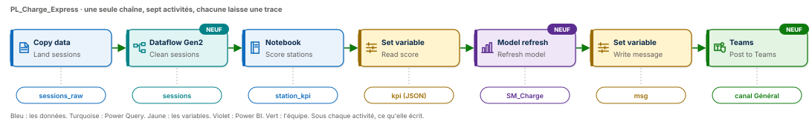
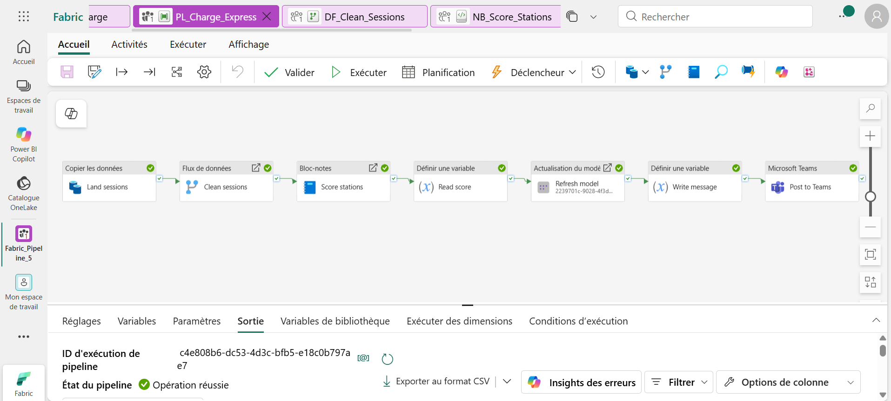
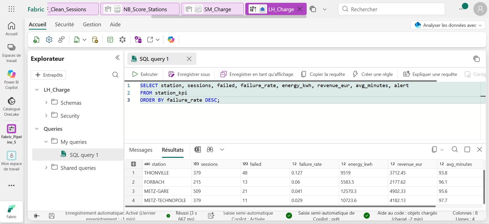

# ⚡ Fabric Pipeline Express 5 : nettoyer, scorer, publier, prévenir


Un pipeline Microsoft Fabric Data Factory qui fait travailler ensemble les quatre moteurs de Fabric. Data Factory pose le fichier brut, Power Query le nettoie sans une ligne de code, Spark calcule les indicateurs et rend son verdict, Power BI se met à jour, et l'équipe reçoit le bilan dans Microsoft Teams. Sept activités sur une seule ligne, trois types d'activité nouveaux, et un seuil d'alerte que l'on change au lancement sans toucher au pipeline.

**Guide PDF de 7 pages inclus** : [`Pipeline_Fabric_Guide_5_public.pdf`](Pipeline_Fabric_Guide_5_public.pdf). Chaque activité, chaque champ, chaque expression, et les chiffres à retrouver à l'unité près. Toutes les expressions sont aussi dans [`data/expressions.txt`](data/expressions.txt), prêtes à copier, et le notebook s'importe tel quel : [`data/NB_Score_Stations.ipynb`](data/NB_Score_Stations.ipynb).



## 📸 Aperçu

Le pipeline `PL_Charge_Express` après une exécution réussie : sept activités, sept coches vertes, de la copie du fichier brut jusqu'au message posté dans Teams.



La table `station_kpi` interrogée dans le point de terminaison SQL du lakehouse : quatre stations, leur taux de sessions en échec, l'énergie livrée et le chiffre d'affaires. Thionville dépasse le seuil d'alerte.



## 🎯 Résultats clés

| Indicateur | Valeur |
|---|---|
| Activités | 7 (Copy data, Dataflow, Notebook, Set variable ×2, Semantic model refresh, Microsoft Teams) |
| Types d'activité nouveaux | 3 : Flux de données, Actualisation du modèle sémantique, Microsoft Teams |
| Moteurs Fabric mis à contribution | 4 : Data Factory, Power Query, Spark, Power BI |
| Lignes reçues dans le fichier brut | 1 509 |
| Sessions propres après nettoyage | 1 482 (12 illisibles, 9 doublons, 6 énergies négatives écartés) |
| Taux d'échec le plus élevé | 12,7 % à Thionville, trois fois celui de Metz Gare |
| Énergie livrée sur la semaine | 38 396 kWh |
| Chiffre d'affaires des quatre stations | 14 974,53 € |

## 💼 Impact métier

Quatre stations de recharge en Moselle, Metz Gare, Metz Technopôle, Thionville et Forbach, exportent chaque semaine leurs sessions. Une borne qui échoue trop souvent, c'est un conducteur qui repart sans charge et une réputation qui s'abîme. Ce pipeline transforme un fichier brut et sale en une réponse claire, livrée là où l'équipe travaille déjà : quelle station dépasse le seuil, de combien, et ce que la semaine a représenté en énergie et en sessions. Le rapport Power BI est à jour au moment où le message arrive, et le seuil se règle au lancement selon l'exigence du moment.

## 📝 Résumé

`PL_Charge_Express` copie `sessions_semaine40.csv` du dossier `Files/inbox` du lakehouse vers la table brute `sessions_raw`, toutes colonnes en texte. Le flux de données Gen2 `DF_Clean_Sessions` applique six étapes Power Query : types, suppression des erreurs, suppression des doublons, filtre des énergies négatives, colonne de durée, puis écriture de la table `sessions`. Le notebook `NB_Score_Stations` reçoit le seuil du pipeline, calcule les indicateurs par station dans `station_kpi` et renvoie un verdict JSON. Le pipeline range ce verdict dans une variable, actualise le modèle sémantique Direct Lake `SM_Charge`, rédige le message avec une seule expression `if()` et le poste dans le canal Teams de l'équipe.

## 🔁 Pipeline

| Activité | Type | Rôle |
|---|---|---|
| `Land sessions` | Copy data | Pose le CSV brut dans `sessions_raw`, action Remplacer, rien n'est perdu |
| `Clean sessions` | Flux de données | Exécute `DF_Clean_Sessions` : 1 509 lignes entrent, 1 482 sessions sortent dans `sessions` |
| `Score stations` | Notebook | `NB_Score_Stations`, paramètres `threshold` = `@pipeline().parameters.alert_threshold` et `run_id` = `@pipeline().RunId` |
| `Read score` | Set variable | `kpi` = `@activity('Score stations').output.result.exitValue` |
| `Refresh model` | Actualisation du modèle sémantique | Actualise `SM_Charge` en entier, le rapport montre les chiffres de cette exécution |
| `Write message` | Set variable | `msg` = une expression `if()` qui choisit entre l'alerte et le « tout va bien » |
| `Post to Teams` | Microsoft Teams | Poste `@{variables('msg')}` dans le canal Général de l'équipe |

## 🧠 Les quatre idées du projet

**Chaque moteur à sa place.** Power Query pour nettoyer, parce que chaque étape se voit, se relit et se corrige dans le volet des étapes appliquées. Spark pour calculer, parce qu'un taux par station se dit en dix lignes. Le pipeline, lui, ne fait qu'enchaîner et décider.

**Brut d'abord, propre ensuite.** Le Copy écrit tout en texte : la valeur `ERR` passe sans casser le chargement. C'est au nettoyage de la refuser, pas à l'atterrissage. Le fichier reçu reste consultable tel quel dans `sessions_raw`.

**Un contrat de sortie.** Le notebook ne renvoie pas « OK », il renvoie un JSON avec cinq valeurs : sessions, énergie, nombre d'alertes, pire station, pire taux. Le pipeline le lit une fois dans la variable `kpi` et s'en sert partout avec `json(variables('kpi'))`.

**La décision dans l'expression.** Pas de Condition Si : la fonction `if()` choisit entre deux phrases. Une seule activité Teams suffit, et le pipeline reste une ligne droite, lisible d'un coup d'œil.

## 🍳 Le pipeline en une image

| Étape | Dans une cuisine de restaurant | Dans Fabric |
|---|---|---|
| 1 | La livraison dépose les cartons en réserve, sans les ouvrir | Copy data pose le fichier brut |
| 2 | Le commis trie, lave, jette l'abîmé et les doublons | Power Query nettoie |
| 3 | Le chef cuisine et rend un verdict écrit | Le notebook calcule et renvoie son JSON |
| 4 | Le menu affiché se met à jour | Power BI s'actualise |
| 5 | Le serveur annonce en salle | Teams prévient l'équipe |

## 🧬 Traçabilité

```
LH_Charge / Files / inbox / sessions_semaine40.csv          1 509 lignes, tout en texte
   │  Copy data Land sessions
   ▼
LH_Charge / Tables / sessions_raw                           1 509 lignes
   │  Flux de données Clean sessions (DF_Clean_Sessions)
   │     types · erreurs (12) · doublons (9) · énergie ≥ 0 (6) · duration_min
   ▼
LH_Charge / Tables / sessions                               1 482 sessions
   │  Notebook Score stations (NB_Score_Stations, threshold = 0.1)
   ▼
LH_Charge / Tables / station_kpi                            4 stations, run_id de l'exécution
   │  exitValue  {"sessions": 1482, "energy_kwh": 38396, "alerts": 1, "worst": "THIONVILLE", "worst_pct": 12.7}
   ▼
Set variable Read score ──▶ kpi
Actualisation du modèle sémantique Refresh model ──▶ SM_Charge (Direct Lake)
Set variable Write message ──▶ msg
Microsoft Teams Post to Teams ──▶ canal Général
```

## 🏗️ Architecture

| Objet Fabric | Type | Rôle |
|---|---|---|
| `LH_Charge` | Lakehouse | Le fichier reçu dans `Files/inbox`, puis les tables `sessions_raw`, `sessions`, `station_kpi` |
| `DF_Clean_Sessions` | Dataflow Gen2 | Les six étapes de nettoyage Power Query |
| `NB_Score_Stations` | Notebook PySpark | Les indicateurs par station et le verdict JSON |
| `SM_Charge` | Modèle sémantique Direct Lake | Lit les tables Delta du lakehouse sans les copier |
| `PL_Charge_Express` | Pipeline | Enchaîne les sept activités, paramètre `alert_threshold` (Float, 0.1 par défaut) |

Direct Lake change la nature de l'actualisation : rien n'est rechargé, le modèle pointe simplement vers la dernière version des tables Delta. Quelques secondes, quel que soit le volume.

## ▶️ Les deux exécutions

| # | `alert_threshold` | Ce qui se passe | Message reçu dans Teams |
|---|---|---|---|
| 1 | `0.1` | Thionville dépasse le seuil | Alerte bornes : 1 station(s) au-dessus du seuil de 0.1. La pire : THIONVILLE avec 12.7 % de sessions en échec. |
| 2 | `0.15` | Aucune station au-dessus du seuil, mêmes 1 509 et 1 482 lignes | Bornes de recharge : aucune station au-dessus du seuil de 0.15. 1482 sessions, 38396 kWh livrés. |

Tout est remplacé à chaque exécution : la table brute, la table propre, les indicateurs. Relancer dix fois donne dix fois 1 482 sessions.

## 📊 Résultat final

```sql
SELECT station, sessions, failed, failure_rate, energy_kwh, revenue_eur, avg_minutes, alert
FROM station_kpi
ORDER BY failure_rate DESC;
```

| station | sessions | failed | failure_rate | energy_kwh | revenue_eur | avg_minutes |
|---|---|---|---|---|---|---|
| **THIONVILLE** | 379 | 48 | **0.127** | 9 519,0 | 3 712,45 | 93,8 |
| FORBACH | 215 | 13 | 0.06 | 5 583,5 | 2 177,62 | 96,1 |
| METZ-GARE | 509 | 21 | 0.041 | 12 570,3 | 4 902,33 | 95,6 |
| METZ-TECHNOPOLE | 379 | 11 | 0.029 | 10 723,6 | 4 182,13 | 97,7 |

## 📦 Jeu de données

```
data/
├── sessions_semaine40.csv     1 509 lignes, du 28 septembre au 4 octobre 2026
├── NB_Score_Stations.ipynb    le notebook, à importer tel quel dans Fabric
└── expressions.txt            toutes les expressions du guide, prêtes à copier
```

Huit colonnes : `session_id`, `station`, `charger_id`, `start_time`, `end_time`, `energy_wh`, `price_cents`, `status` (`completed` ou `failed`). Seize bornes réparties sur quatre stations. Les défauts sont volontaires : 12 énergies illisibles (`ERR`), 9 sessions envoyées deux fois, 6 énergies négatives. Données fictives, conçues pour l'exercice.

## 🚀 Reproduire l'exercice

1. Créer un lakehouse `LH_Charge`, un dossier `Files/inbox`, et y déposer `sessions_semaine40.csv`.
2. Créer le pipeline `PL_Charge_Express` avec la seule activité `Land sessions`, et l'exécuter : `sessions_raw` apparaît.
3. Créer le flux de données Gen2 `DF_Clean_Sessions` sur `sessions_raw`, appliquer les six étapes, écrire `sessions`, puis **Enregistrer et exécuter**.
4. Importer `NB_Score_Stations.ipynb`, lui attacher `LH_Charge`, **Exécuter tout** : `station_kpi` apparaît.
5. Depuis le lakehouse, créer le modèle sémantique `SM_Charge` sur `sessions` et `station_kpi`.
6. Compléter le pipeline avec les six autres activités en suivant le guide, puis exécuter avec `0.1` et `0.15`.

## 📂 Structure du dépôt

```
fabric-pipeline-express-5/
├── README.md
├── Pipeline_Fabric_Guide_5_public.pdf   le guide de 7 pages
├── data/                               le fichier de sessions, le notebook, les expressions
└── images/
    ├── pipeline_diagram.svg            le schéma du pipeline
    ├── pipeline_run.png                PL_Charge_Express après une exécution réussie
    └── sql_results.png                 la table station_kpi dans le point de terminaison SQL
```

## 🧰 Stack technique

Microsoft Fabric Data Factory · Dataflow Gen2 et Power Query · Notebook PySpark · Lakehouse et Delta Lake · Modèle sémantique Direct Lake · Microsoft Teams · Point de terminaison SQL

## ✅ Conclusion

Un pipeline n'a pas besoin de tout faire lui-même. Il a besoin de confier chaque tâche au bon moteur, de lire ce que chacun lui rend, et de décider. Sept activités, quatre moteurs, une ligne droite : du fichier sale au message dans Teams, avec un rapport à jour au passage.

## 💭 Dernier mot

La donnée n'a de valeur que si elle arrive là où quelqu'un peut agir. Ici, elle arrive dans la conversation de l'équipe, avec le nom de la station et le chiffre qui compte.

---

Abdoul Hamid Diallo · Microsoft Data & AI Engineer · Microsoft Certified DP-600, DP-700, PL-300, AI-102, DP-100, AI-900, DP-900 · [LinkedIn](https://www.linkedin.com/in/abdoul-hamid-diallo-fabric-data-engineer/)
